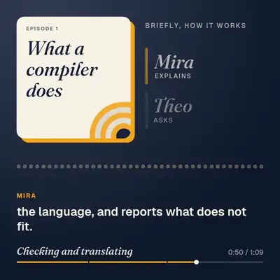

# podcast-studio

[](https://github.com/VinVirtual/podcast-studio/actions/workflows/test.yml) [](LICENSE)

Turn a written article or a dialogue script into a finished podcast episode, made entirely on your own machine.

<p align="center"></p>

You write one JSON file: the **episode** (show, title, speakers, chapters and who says what). podcast-studio records every line with a local text-to-speech model, puts natural gaps between the turns, adds a quiet music bed under the intro and outro, sets the loudness to podcast level and measures it, and writes:

- `episode.mp3` and `episode.m4a` with tags and **chapter marks** inside the file
- `episode.vtt` and `episode.srt` captions with **speaker names**
- `chapters.txt` (`0:00 Title` lines for a description) and `chapters.json` (Podcasting 2.0 format)
- `notes.md` show notes: title, summary, chapters, voices, source and the full transcript
- `episode-<format>.mp4` an **audiogram** for social media: vertical, square or landscape, with the cover, the speaker's name lit up, sound bars or a waveform drawn from the real audio, and captions highlighted word by word
- `preview.webp` a short silent looping clip

Nothing is uploaded and no paid service is used. It is packaged as a [Claude Code](https://claude.com/claude-code) skill (`SKILL.md` teaches the assistant how to write a faithful dialogue from an article and how to run the pipeline), and it also works by hand from the command line.

## Listen to the example

`examples/compiler/` is a 69-second episode, "What a compiler does", written for this repository: the script (`episode.json`) and everything made from it in `out/` (MP3, captions, chapters, show notes and a 720 px audiogram).

Measured on the finished MP3 by `podcast verify`: -16.0 LUFS integrated (target -16), true peak -1.7 dBFS (ceiling -1), no clipped samples, longest silence between two words 0.98 s (a chapter break), all 12 turns found at their planned times. The six factual claims in its script are marked unconfirmed, because only a reader can confirm them; by the skill's own rule that makes the example a draft, and `podcast lint --strict` says so.

## Limits

Read these before you publish an episode.

- **The voices are synthetic and sound it.** Kokoro is good for a free local model, but it has a fixed set of voices that do not sound fully human: the rhythm is even, emphasis is sometimes wrong, and questions do not always rise. Listen to every episode before publishing.
- **Tell your listeners.** The show notes and the files' comment tag say the voices are computer-generated, and the example script has each voice say so in the opening. Keep it that way.
- **No voice cloning.** You cannot make it sound like a particular person, and you should not present the voices as real people.
- **No real conversation effects.** Speakers never interrupt, talk over each other, laugh, breathe or say "mm-hm" under the other voice. A short reaction ("Right.") can be written as its own turn and comes in quickly, but that is all. Text in brackets or asterisks is not performed.
- **English works best.** Kokoro also has voices for British English, Spanish, French, Hindi, Italian, Japanese, Brazilian Portuguese and Mandarin Chinese, but the caption timing and the lint rules are tuned for English and the other languages were not tested.
- **Word timing is estimated.** Kokoro does not report when each word is spoken. Each sentence is recorded separately, so sentence starts are exact; inside a sentence, the pauses found in the recording are matched to the commas and the words share the time between them by syllable count. A highlighted word can be a fraction of a second early or late.
- **Facts are your responsibility.** Lint makes every claim name its source and checks spoken digits, spelled-out numbers ("nineteen seventy", "half") and quotations against the claims list, but it cannot spot every factual statement. The skill tells the assistant not to add facts, numbers or quotations that are not in the source, and to list every claim for you to confirm, and lint checks spoken numbers and quotes against that list. It cannot check that the claims are true.
- **The music is a simple generated pad.** You can use your own music file instead (`music.file`), if you have the rights to it.
- **Tested on Linux only**, with Chrome. The scripts may work on macOS; Windows is untested.

## Requirements

| Needed | Why | Licence |
|---|---|---|
| Node.js 18 or newer | runs the command line and drives the browser | MIT |
| [playwright-core](https://www.npmjs.com/package/playwright-core) | drives the browser that draws the video frames | Apache-2.0 |
| Google Chrome, Chromium or Playwright's own Chromium | draws the frames | Chrome: proprietary freeware. Chromium: BSD-style and others |
| Python 3.10 to 3.13 (the versions kokoro-onnx supports) | runs the voice and the mix | PSF |
| [kokoro-onnx](https://github.com/thewh1teagle/kokoro-onnx) | text to speech | MIT |
| Kokoro v1.0 model files (`kokoro-v1.0.onnx`, `voices-v1.0.bin`, about 340 MB) | the voice model | Apache-2.0 (see the notes) |
| phonemizer and espeak-ng (installed with kokoro-onnx) | turn text into phonemes | GPL-3.0-or-later |
| onnxruntime, numpy, soundfile | run the model, process and write audio | MIT, BSD-3-Clause, BSD-3-Clause |
| ffmpeg with libmp3lame, the native AAC encoder, libx264 and the ebur128 and alimiter filters (soxr resampling is used when present, else ffmpeg's own) | measures loudness, encodes MP3, M4A and MP4 | LGPL or GPL depending on the build; see the notes |

None of these is included in this repository. You install them yourself, and their licences apply to your use of them. About 1 GB of disk and 4 GB of free memory are enough; no GPU is needed.

### Licence notes

Checked on 21 November 2026 from the package metadata installed on the test machine, unless said otherwise. Check again before you rely on them. This is not legal advice.

- **kokoro-onnx** is MIT (its `LICENSE` file). Its README says the Kokoro model is Apache-2.0.
- **Kokoro-82M** (the model, by hexgrad) is tagged Apache-2.0 on its Hugging Face model card. No separate licence is given for the individual voice files in `voices-v1.0.bin`; this could not be verified beyond the model's own tag.
- **phonemizer** is GPL-3.0-or-later (package metadata). **espeak-ng** is GPL-3.0-or-later (its project README); the `espeakng-loader` package that ships `libespeak-ng.so` to kokoro-onnx states no licence in its own metadata. Both are loaded inside the Python process that runs `engine/audio.py`. podcast-studio does not include or link them in this repository, but if you redistribute a bundle that includes them, or build a product on top, read the GPL's terms.
- **ffmpeg** runs as a separate program. The binary that the `imageio-ffmpeg` package downloads (the package itself is BSD-2-Clause) is built with `--enable-gpl --enable-version3`, so that binary is under the **GPL-3.0-or-later**. A system ffmpeg may be LGPL or GPL depending on how it was built.
- **MP3 encoder**: MP3 files are made by ffmpeg's `libmp3lame`, which is the LAME encoder, licensed **LGPL-2.0-or-later** according to the LAME project. The main MP3 patents have expired, and the licensing programme of Fraunhofer IIS and Technicolor ended in April 2017; no MP3 patent licence is needed to encode or distribute MP3 files. (From general knowledge, not checked online for this release.)
- **AAC encoder** (the `.m4a` file and the MP4's sound): ffmpeg's native AAC encoder, under ffmpeg's licence. AAC is still covered by patents in some countries, licensed through a patent pool (Via LA) to makers of encoders and decoders in products. Making and publishing AAC files for your own podcast is generally not something you pay royalties for, but if you ship podcast-studio inside a product, check. Leave `"m4a"` out of `audio.formats` if you only want MP3. (From general knowledge, not checked online for this release.)
- **H.264** in the audiogram MP4 comes from ffmpeg's `libx264` (GPL-2.0-or-later). H.264 is patent-licensed by a pool (Via LA, formerly MPEG LA); free internet video to end users has been royalty-free under that pool's terms.
- **Bundled fonts** (`assets/fonts/`): Fraunces (Copyright 2020 The Fraunces Project Authors) and Geist (Copyright 2024 The Geist Project Authors), both under the **SIL Open Font License 1.1**, as stated inside each font file; `OFL.txt` travels with them.
- **Episodes you make** are yours. Check the licence of any cover image or music file you add, and that you may adapt the article you turn into an episode.

podcast-studio's own code is under the **MIT License** (see `LICENSE`). Parts of it (finding Python, ffmpeg, Playwright and a browser; the frame-capture loop; the caption time stamps; the environment check) were copied and adapted from its sister project reel-studio by the same author, also MIT.

## Install

```bash
# 1. the skill itself (for Claude Code; any folder works if you only use the command line)
git clone https://github.com/VinVirtual/podcast-studio ~/.claude/skills/podcast-studio

# 2. voice: a Python venv with Kokoro, and the two model files
#    Use Python 3.10 to 3.13. If your python3 is newer, name one in that range, e.g. python3.12.
#    On Debian and Ubuntu the venv module is a separate package: sudo apt install python3-venv (or python3.12-venv)
python3.12 -m venv ~/kokoro/.venv
~/kokoro/.venv/bin/pip install kokoro-onnx soundfile numpy imageio-ffmpeg
curl -L -o ~/kokoro/kokoro-v1.0.onnx https://github.com/thewh1teagle/kokoro-onnx/releases/download/model-files-v1.1/kokoro-v1.0.onnx
curl -L -o ~/kokoro/voices-v1.0.bin  https://github.com/thewh1teagle/kokoro-onnx/releases/download/model-files-v1.1/voices-v1.0.bin

# 3. video: Playwright, and a browser if you have no Chrome
npm i -g playwright-core
npx playwright-core install chromium     # optional when Google Chrome is installed

# 4. check
~/.claude/skills/podcast-studio/podcast check
```

`imageio-ffmpeg` brings its own ffmpeg. Leave it out if you already have an ffmpeg with libmp3lame on your PATH. No other Python or npm package is needed; pytest is used for the Python tests when it is installed.

Everything is found in default places that you can change with environment variables:

| Variable | Default | What |
|---|---|---|
| `KOKORO_HOME` | `~/kokoro` | folder with the model files and the `.venv` |
| `KOKORO_MODEL`, `KOKORO_VOICES` | `$KOKORO_HOME/kokoro-v1.0.onnx`, `$KOKORO_HOME/voices-v1.0.bin` | the two model files |
| `PODCAST_PYTHON` | `$KOKORO_HOME/.venv/bin/python`, else `python3` | Python that has kokoro-onnx |
| `FF` | `ffmpeg` on PATH, else the one from imageio-ffmpeg | ffmpeg binary |
| `PLAYWRIGHT_CORE` | the skill's own `node_modules`, else the global npm folder (`npm root -g`); never the current folder | folder of playwright-core |
| `PODCAST_CHROME` | installed Chrome, then other browsers, then Playwright's Chromium | browser binary to try first |

## Quick start

```bash
S=~/.claude/skills/podcast-studio
$S/podcast new my-episode        # my-episode/episode.json from the template
# write the dialogue in my-episode/episode.json (or ask Claude to turn an article into one)
$S/podcast lint my-episode       # speakers, voices, long lines, balance, pronunciations, claims, length
$S/podcast build my-episode      # audio, checks, captions, chapters, notes, review sheet and video
```

Then listen to `my-episode/out/episode.mp3`, look at `my-episode/stills/sheet-vertical.png`, and watch the video.

To rebuild the example:

```bash
$S/podcast new demo && cp $S/examples/compiler/episode.json demo/
$S/podcast build demo --format square --size 720 --crf 28
```

## Commands

| Command | What it does |
|---|---|
| `podcast check` | checks Python, Kokoro, ffmpeg (and its encoders and filters), node, Playwright and that a browser really starts |
| `podcast new <dir>` | starts a project from the template |
| `podcast lint <project>` | unknown speakers or voices, turns and sentences too long to sound natural, unbalanced speaker share, words likely to be misread with no pronunciation, unconfirmed claims, numbers and quotes not in the claims, missing files, estimated length against `target_seconds`. `--strict` fails on warnings, `--json` prints JSON |
| `podcast phonemes <project> ["text" ...]` | how the voice will pronounce each flagged word (or the text you give), in phonetic letters, without recording |
| `podcast audio <project>` | records new or changed sentences only, lays out the turns, mixes, normalises, encodes MP3/M4A with chapters, and writes captions, chapter lists and notes. Prints the loudness measured before and after. `--dry-run` lists what would be recorded |
| `podcast verify <project>` | decodes the finished file and checks it: length, loudness (every file within 0.5 LU), true peak at or under `audio.peak`, long silences, every turn at its time, speakers equally loud. Each failure comes with what to change |
| `podcast captions <project>` | `out/episode.vtt` and `.srt` |
| `podcast chapters <project>` | writes the chapters into the audio files again and reads them back, plus `chapters.txt` and `chapters.json` |
| `podcast notes <project>` | `out/notes.md` |
| `podcast sheet <project>` | `stills/sheet-<format>.png`: up to nine frames of the video in one picture, and a list of anything that did not fit |
| `podcast video <project>` | `out/episode-<format>.mp4` |
| `podcast preview <project>` | `out/preview.webp` (or `--gif`): a short silent loop cut from the video. `--at 12 --seconds 5 --width 480 --fps 12` |
| `podcast clean <project>` | deletes recordings in `build/takes` that no line of the script uses any more. `--all` deletes the whole build folder |
| `podcast build <project>` | all of the above in order; stops before the video if the audio fails a check. `--no-video` |
| `podcast test` | runs the unit tests |

`captions`, `chapters`, `notes`, `verify`, `sheet` and `video` refuse to run when `episode.json` changed in a way that affects the audio since `podcast audio` last ran, and say so; run `podcast audio` again (unchanged lines are not recorded again). Files named in the script (`cover.image`, `music.file`) must be inside the project folder.

Video options: `--format vertical|square|landscape`, `--style bars|wave`, `--size 1080` (short side in pixels), `--crf 20`, `--no-captions`, `--workers 2`.

## How it works

1. **Script to sentences** (`engine/lib/episode.mjs`, `plan.mjs`). Each turn is split into sentences. A sentence's recording is named by a hash of its spoken text, voice, speed and language, so only sentences where one of those changed are recorded again.
2. **Voices** (`engine/audio.py synth`). Kokoro records each new sentence; leading and trailing silence is trimmed and the pauses inside are found.
3. **Timing** (`engine/lib/timing.mjs`). Turns are placed one after another with a gap that depends on what came before: short after a question or for a short reaction, longer when the same speaker goes on, longest at a new chapter, each varied slightly. Gaps are never negative, so speakers never overlap. Word times inside each sentence are estimated (see Limits). Everything downstream reads this one timeline.
4. **Mix** (`engine/audio.py mix`). Speakers are levelled to the same speech loudness and placed slightly left and right; the music bed plays under the intro and outro and ducks under speech.
5. **Loudness** (`engine/lib/loudness.mjs`, `audio.mjs`). ffmpeg's EBU R128 meter measures the mix. The gain to the target (-16 LUFS stereo, -19 LUFS mono, or `audio.lufs`) is applied with a look-ahead limiter that runs at 4x the sample rate, so it also catches peaks between samples, set a little under the true-peak ceiling (`audio.peak`, default -1 dBFS). The master is measured and corrected until it is within 0.1 LU. Then the files are encoded and measured (true peak with ffmpeg's 4x oversampled meter). If any file is over the ceiling or more than 0.3 LU off the target, the limiter margin and the level are adjusted and the round runs again, up to four times. `verify` then accepts ±0.5 LU and nothing over the ceiling, and prints what to change when it fails.
6. **Files**. MP3/M4A with tags and chapters (written from an FFMETADATA file and read back to check), VTT/SRT, chapter lists and notes.
7. **Checks** (`engine/lib/verify.mjs`, `engine/audio.py verify`). The finished file is decoded and compared with the voice-only mix turn by turn (the loudness curve of each turn must match at its planned time).
8. **Audiogram** (`engine/audiogram.js`, `engine/lib/video.mjs`). A spectrum and level per video frame are computed from the mastered audio. A canvas page draws any frame as a pure function of time, so frames are drawn in several browser pages at once and piped to ffmpeg in order.

## Development

```bash
./podcast test                       # all node and Python tests
node --test tests/*.test.mjs         # node tests only
python3 -m pytest tests              # Python tests only (needs numpy; pytest optional, see tests/run_py_tests.py)
```

An integration test (`tests/integration.test.mjs`) puts stub voices (a harmonic tone with syllable bursts per sentence, as peaky as real speech) through the real mix, normalise, encode and verify path at -16, -14 and -12 LUFS, and checks that every file lands on its target with its true peak under the ceiling. It needs Python with numpy and soundfile and an ffmpeg with libmp3lame, and is skipped without them.

The node tests cover turn timing and gaps, word timing, chapter maths and the FFMETADATA writer and reader, the caption writers, incremental planning, every lint rule, the loudness gain maths and the master loop, show notes, the verify verdicts and their advice, the stale-timeline guard, `clean`, and that Playwright is never loaded from the current folder. The Python tests cover the signal helpers: trimming, pause finding, speech level, speaker levelling, panning, the music envelope and ducking, chords, silence detection, the turn matcher and the spectrum data.
